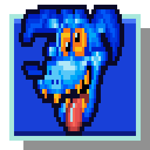
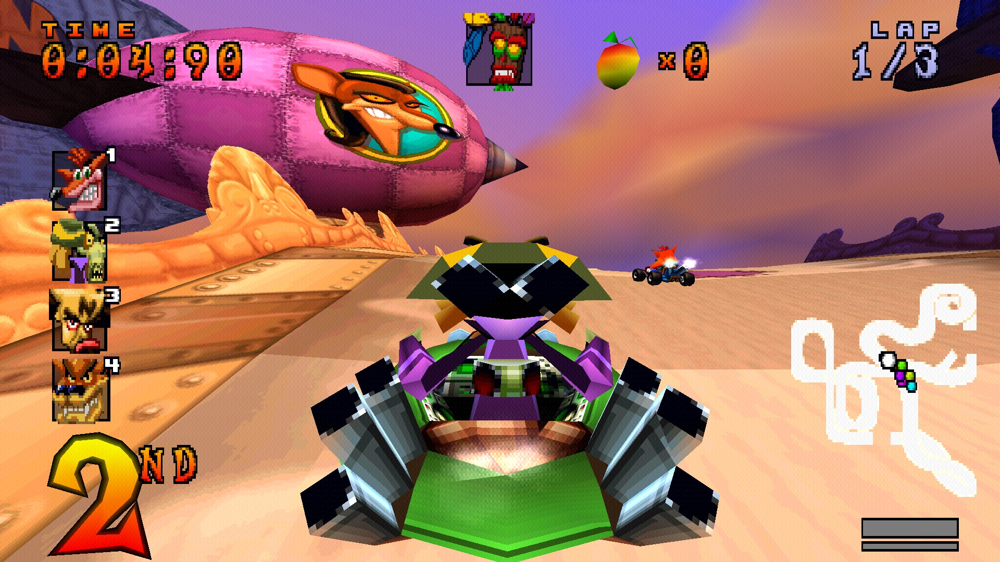
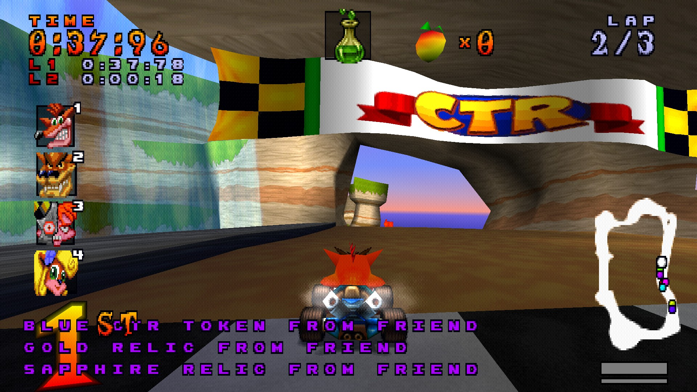
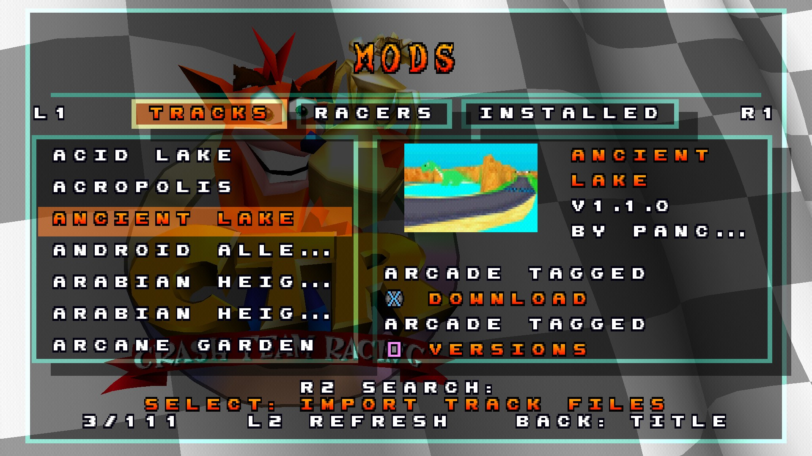

<p align="center"></p>

# CTR Decrypted

A native PC version of **Crash Team Racing (PS1, 1999)** with the [Archipelago](https://archipelago.gg) multiworld randomizer built in and High Octane-style enhancements.

- No emulator and no ROM patching: the game is compiled from the [CTR-native](https://github.com/CTR-tools/ctr-native) decompilation.
- You supply your own NTSC-U disc image; the game reads its assets from it.

<p align="center"></p>

CTR Decrypted is built on [dowlle/ctr-native-ap](https://github.com/dowlle/ctr-native-ap) and stays compatible with its seeds and `ctr.apworld`. It adds enhancements ported from [Crash Team Racing - High Octane](https://github.com/Rinnegatamante/Crash-Team-Racing-High-Octane), plus fixes of its own. [ROADMAP.md](ROADMAP.md) has what is planned.

## Features

<p align="center">
  
  
</p>

On top of the Archipelago client:

- **Custom tracks** (**MODS** on the title screen): install community tracks from Project Saphi, from an xdelta patch or by hand, and race them in Arcade and Time Trial from extra pages of the track select. A seed can also put a custom track into a Gem Cup ([docs/CUSTOM_TRACKS.md](docs/CUSTOM_TRACKS.md)).
- **Custom racers** (**MODS → Racers**): add community characters to the character select, beside the retail racers and N. Oxide ([docs/CUSTOM_RACERS.md](docs/CUSTOM_RACERS.md)).
- **Play Solo** (title screen): generate and play a one-player seed on your own machine, with no room to host.

And in OPTIONS:

- **Save backups**: the last 10 copies of your save and Play Solo progress, made automatically, with a restore in **OPTIONS → Backups** ([SETUP.md](SETUP.md#backups-going-back-to-an-earlier-save)).
- **60 FPS**, on by default, in every mode ([docs/60FPS.md](docs/60FPS.md)).
- **PGXP anti-wobble** and perspective-correct textures, with a depth test that keeps water from painting over nearer ground ([docs/PGXP.md](docs/PGXP.md)).
- **Screen filters**: Sharp Bilinear, FXAA, Scanlines, CRT ([docs/SCREEN-FILTERS.md](docs/SCREEN-FILTERS.md)).
- **Extras**: reserves meter, kept reserve fire, blue fire at Ultimate Speed Fire, slide meter gradient, cyan super pads ([docs/EXTRAS.md](docs/EXTRAS.md)).
- **Playable N. Oxide**, unlocked by beating him in Adventure.
- Widescreen, render scale, increased draw distance (with no far scenery dropping out: [docs/LEVEL-VISIBILITY.md](docs/LEVEL-VISIBILITY.md)), remappable controls, and native Switch 2 Pro Controller support (with Steam closed).
- The one-player camera distance you pick with `L2` is kept across races, hubs and sessions (`camera_far` under `[State]` in `config.ini`). Split screen starts near, as the original does. The map or speedometer you pick with `Triangle` is kept the same way (`hud_speedometer`).

## Getting started

**1. Download** `ctr-decrypted-vX.Y.Z-windows-x86.zip` from the [latest release](https://github.com/Decryptu/ctr-decrypted/releases/latest) and extract it (Linux: the `-linux-x86.tar.gz`). After that the game updates itself: when a new version is out, the main menu offers it, and accepting installs it and restarts the game. Your settings and saves stay.

**2. Add your disc image.** This project contains no game assets. You must own a retail **NTSC-U** copy of Crash Team Racing, dumped as a raw single-track `.bin` (MODE2/2352). A 2048-byte `.iso` won't work: it loses the audio and video sectors. On the first launch the game looks for it in the game folder, Downloads, Desktop, Documents and Games and asks to use what it finds; otherwise a file picker opens. You can also put it in an `assets` folder next to the executable yourself.

```
CTR-Decrypted/
  ctr_native_ap.exe
  assets/
    ctr-u.bin
```

**3. Connect to your Archipelago room.** The first launch opens a short setup on the title screen: enter the server address (for example `archipelago.gg:38281`), your slot name and the password, then pick a few options. Later, change them in **OPTIONS → Connection**. The settings are saved to `config.ini`.

## Making a multiworld

- Each player makes a YAML options file, for example with the [CTR YAML Builder](https://ap-pie.com/apworlds?build=ctr).
- The person generating the room installs the `ctr.apworld` shipped with the release into Archipelago's `custom_worlds` folder, then generates with every player's YAML.
- Host the result on [archipelago.gg](https://archipelago.gg/uploads) or with your own Archipelago server.

[SETUP.md](SETUP.md) has the full walkthrough and troubleshooting.

## Building from source

See [BUILDING.md](BUILDING.md).
- Windows builds use MSYS2 MinGW32.
- The game is 32-bit only for now.

## Keeping up with upstream

Upstream branches are imported with `tools/decrypted/sync-upstream.ps1`. It writes `clean/<remote>-<branch>`, which you then merge.

## License

GPL-3.0, inherited from CTR-native. See [LICENSE](LICENSE) and [THIRD_PARTY_NOTICES.md](THIRD_PARTY_NOTICES.md). The `ctr.apworld` is MIT-licensed. This repository contains no game assets.

## Credits

- [CTR-tools/ctr-native](https://github.com/CTR-tools/ctr-native) and [CTR-ModSDK](https://github.com/CTR-tools/CTR-ModSDK): the decompilation and native port everything here is built on.
- [dowlle/ctr-native-ap](https://github.com/dowlle/ctr-native-ap) and [ctr-archipelago-apworld](https://github.com/dowlle/ctr-archipelago-apworld): the Archipelago client and world this project is based on.
- [Rinnegatamante/Crash-Team-Racing-High-Octane](https://github.com/Rinnegatamante/Crash-Team-Racing-High-Octane): the source of the 60 FPS mode and other enhancements ported here.
- [thecodingbob/ctr-native](https://github.com/thecodingbob/ctr-native): the config menu, widescreen, borderless fullscreen and dithering options.
- [CTR Turbocharged](https://github.com/CameronRedmore/Crash-Team-Racing-Turbocharged), DuckStation (Stenzek) and iCatButler: the PGXP precision geometry, via High Octane.
- Icebound777 and Taor: the [CTR randomizer](https://github.com/icebound777/CTR-Randomizer-Standalone) whose design the Archipelago integration builds on.
- [PsyCross](https://github.com/OpenDriver2/PsyCross), [SDL3](https://github.com/libsdl-org/SDL), [apclientpp](https://github.com/black-sliver/apclientpp).

Crash Team Racing is a trademark of Sony Interactive Entertainment. This project is not affiliated with Sony or Naughty Dog.
